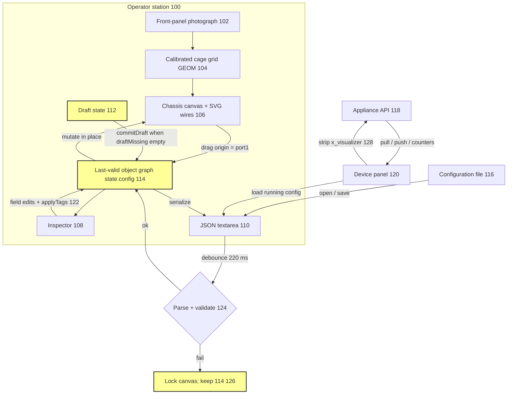
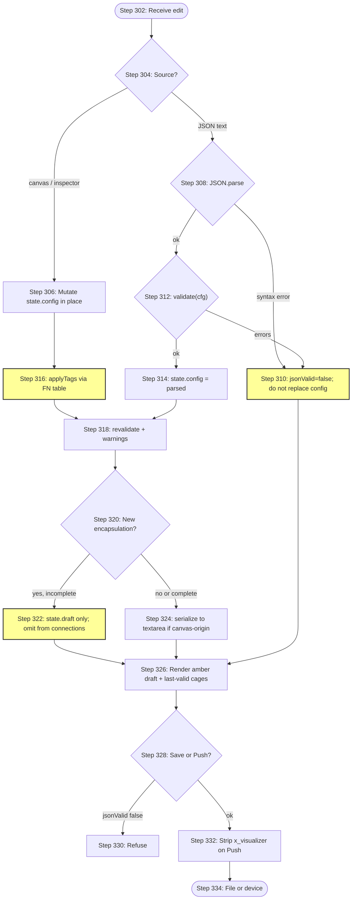
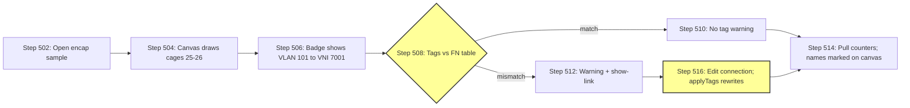
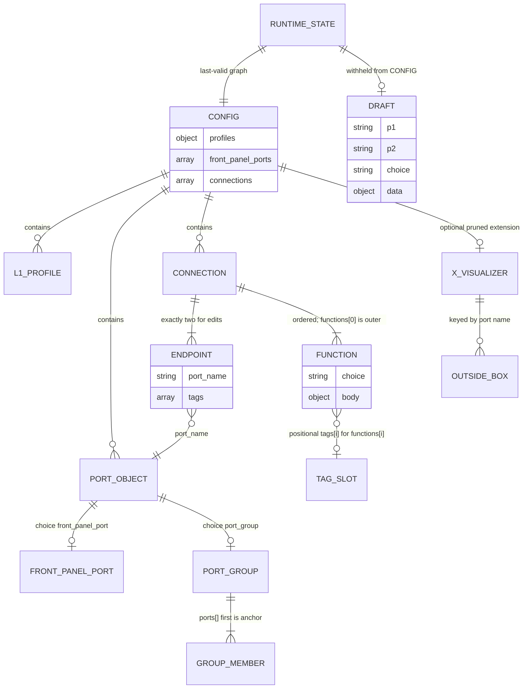
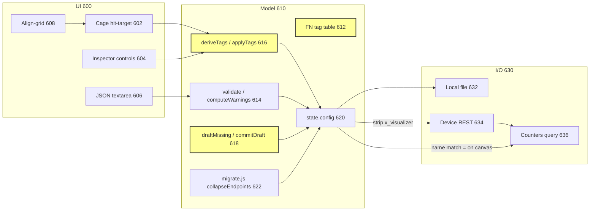

# Invention Disclosure: Bidirectional visual authoring and validation of a network-appliance connectivity configuration over a photorealistic front-panel model

**Local-only draft.** Generated from `prodinfo.md` and the UHD Connect Visualizer codebase. Not published to Google Docs. Not a patent application and not legal advice. Inventor list, conception dates, and public-disclosure facts in §16–§17 of `prodinfo.md` remain inventor/counsel TODOs.

---

## Submission Information

| Field | Value |
|-------|-------|
| Working Title | Method and system for bidirectional visual authoring and validation of a network-appliance connectivity configuration over a photorealistic front-panel model |
| Submitted By | Ashwin Joshi (git author; legal inventor list not confirmed) |
| Submission Date | 2026-08-23 |
| Business Unit | Keysight (UHD Connect / applications) — confirm with PM |
| Product(s) | UHD Connect Visualizer (beta v1.0.0); host appliance Keysight UHD Connect |

---

## Inventors

| # | Name | Citizenship | Contribution |
|---|------|-------------|--------------|
| 1 | Ashwin Joshi | TODO | Sole git author of this reduction to practice. Confirm whether `migrate.js` / `uhd_migration.py` has a distinct co-inventor. Git authorship is not the legal inventor list. |

Detected from git history: `Ashwin Joshi <ashwinjosh@gmail.com>` (6 commits).

---

## Prior Disclosure, Offer to Sell, and/or Actual Sale

| Question | Answer | Details |
|----------|--------|---------|
| Disclosed outside company? | **Likely yes — confirm with counsel immediately** | Remote `https://github.com/ashwinjo/uhdConnectVisualizer.git` is a public-style URL. Initial commit 2026-08-20. US grace period may apply; most other jurisdictions have none. Confirm the date the repo became public. |
| Sold or offered for sale? | Unknown | Beta tool marked for Keysight contacts. Confirm customer demos / distribution. |
| Intention to disclose/sell in future? | Unknown | Confirm whether this is a product SKU, box entitlement, or apps-only tool. |

**Counsel flag:** do not treat this packet as filed. Public GitHub may have already started novelty clocks.

---

## 1. Executive Summary

A computer-implemented system authors, visualizes, and live-verifies the JSON configuration of a multi-port connectivity appliance by overlaying a clickable cage grid on a photograph of the appliance front panel. The parsed configuration object is the single source of truth and is mutated in place, so canvas edits and JSON-text edits stay equivalent without dropping unknown schema fields.

The appliance API at issue accepts a posted document with HTTP 200 even when positional endpoint-role tags do not match the ordered function list, in which case no frames are forwarded. The system never asks the operator to type those tags. It derives them from a function-type metadata table on every canvas edit of a connection. Incomplete encapsulation connections exist only as a UI draft (amber wire) until required tunnel fields are filled; they are omitted from the serializable document. When the JSON text is illegal, the canvas locks and continues to show the last successfully validated object; Save and device Push are refused.

Optional live port counters on names that also exist on the canvas let an operator distinguish “accepted” from “forwarding.” A convert path migrates pre-break schema documents and reconstructs the positional tag model. Display-only far-end labels live under a pruned extension key that is stripped on device push.

Reduction to practice: a static five-file web application (`index.html`, `app.js`, `migrate.js`, `tutorials.js`, `UHDSchematic.png`) that runs from `file://`.

---

## 2. Novelty — What Is New

The inventive step is not “a GUI for JSON” and not “drawing ports on a chassis photo.” Those exist. The inventive step is a dual-view configuration object bound to a calibrated physical faceplate, plus construction rules that close a documented silent-accept hole in a function-centric connectivity schema.

Three mechanisms work together:

1. **Function-driven positional tag synthesis.** Table `FN` in `app.js` stores `tag1`/`tag2` per function choice. `deriveTags(conn)` walks `conn.functions` in order and builds two arrays; `applyTags` writes them onto `endpoints[0]` and `endpoints[1]`, or deletes the `tags` key when the list is empty (Ethernet contributes none). The device API requires `tags[i]` to be that endpoint’s role for `functions[i]`. A short or swapped list returns HTTP 200 and forwards nothing. The visualizer produces the eleven shipped canvas-editable samples’ tags by construction.

2. **Last-valid visual lock.** `applyJsonText` (debounced ~220 ms) parses the textarea. On parse failure or `validate()` errors it sets `state.jsonValid = false` and **does not assign** `state.config`. The chassis keeps drawing the last good object; the lock banner appears; Save (`app.js` ~2231) and Push (`app.js` ~3497) refuse. Revert throws the broken text away. This is not a CRDT: it is an explicit freeze of the last-good object graph while the text stream is illegal.

3. **Withheld encapsulation draft.** `createConnection` for `connect_vlan_vxlan` / `connect_vlan_nvgre` writes `state.draft` and returns without pushing into `connections`. `draftMissing` requires VLAN ID, VNI/VSID, and four outer-header MAC/IP fields. `commitDraft` inserts the connection and then `applyTags`. An empty Ethernet/ARP function is valid and is committed immediately; an empty tunnel is not.

Supporting mechanisms that counsel may claim as dependents: in-place mutation so unaothored keys (`mirror_to`, PFC, pause, `connect_ip`) survive; `x_visualizer` written only when customized, pruned when empty (byte-identical open/save of vendor samples), deleted from the Push payload; overlap/tag-mismatch warnings bound to canvas selection; live counters marked “on canvas”; `collapseEndpoints` in `migrate.js` rebuilding positional tags from legacy `function_N` markers and splitting `vlan_double` into stacked functions (outer first).

**What is not claimed as novel:** a generic JSON Schema form; a generic rack-elevation photo overlay; REST GET/POST of device config; tutorials as documentation.

---

## 3. Context & Environment

The host product is a 32-cage front-panel connectivity appliance. Configuration is one JSON object posted to `https://<unit>/connect/api/v1/config`. The object has three dependent sections: `profiles.layer_1_profiles` (speed / autonegotiation-or-manual / FEC), `front_panel_ports` (name bound to cage 1–32 or a `port_group`), and `connections` (named endpoints plus an ordered `functions` list).

After a host-API schema break on 2026-07-28, endpoints hold only `port_name` plus optional `tags`. Every VLAN, VNI/VSID, MAC and IP lives on a function. Passthrough functions (`connect_ethernet`, `connect_arp`) attach VLANs as `vlan_endpoint_settings_port1` / `_port2` — endpoint order is permanent. Encapsulation functions (`connect_vlan_vxlan`, `connect_vlan_nvgre`) attach settings by role; which physical port plays which role is decided by tags, not array position. Q-in-Q and double encapsulation are not schema types; they are one connection with two functions, `functions[0]` outer.

Operators work in air-gapped labs. The embodiment is offline (`file://`, no build, no server). Device talk is opt-in from a Device panel (pull/push/counters). The authoritative schema is `docs/openapi.json`. Fourteen vendor samples live under `docs/samples/`.

Cage numbering is column-paired: column 1 is ports 1 (top) and 2 (bottom), through 31/32. JSON uses names and integers; the physical box is a photograph. Mismatch between “I used cage 25” and “the file names port 26” is a typical troubleshooting loop.

---

## 4. Problems Solved

Hand-written JSON fails in this domain for structural reasons, not because operators are careless.

**Silent-accept tags.** `tags[i]` is the endpoint role for `functions[i]`. Ethernet omits the key. A tag list shorter than `functions` yields HTTP 200, the posted document returned unchanged, and zero forwarding. Confirmation requires clearing counters, sending traffic, and seeing zeros on egress. There is no error to grep.

**Two VLAN families.** Putting a VLAN on an endpoint (`endpoints[].front_panel.vlan`) is the old schema. Putting it in the wrong function family is the most common authoring mistake. Swapping port1/port2 VLAN blocks silently swaps the two networks.

**Inert but legal tunnels.** Incomplete encapsulation (no VLAN, no VNI/VSID, no outer header), tunnel headers left under old `vlan_endpoint_settings`, UDP ports on the tunnel settings instead of inside the header, and `routing_method` nested inside `protocols` all save and post; the device ignores the misplaced fields.

**No place for topology.** The schema cannot record what a cable runs to (SNIC, server, test port). That mapping lives in spreadsheets disconnected from the file that is pushed.

**Faceplate vs file.** A 32-cage column-paired plate is not recoverable from a name list. Prior practice: text editor, `curl -k -X POST`, metrics query/clear, OpenAPI, and after the schema break a Python CLI migrator (`uhd_migration.py`). This repo has no prior Keysight GUI that drew UHD Connect connections on the faceplate, kept JSON and canvas bidirectional, derived tags, or correlated live counters with the authored canvas.

---

## 5. Background & Introduction

**Cage.** Physical QSFP-class opening, numbered 1–32.

**Layer-1 profile.** Named speed / AN-or-manual / FEC block referenced by ports.

**Connection.** JSON object with `endpoints` + `functions` joining two named ports or groups.

**Function.** One layer of behaviour (`connect_ethernet`, `connect_arp`, `connect_vlan_vxlan`, `connect_vlan_nvgre`, `connect_ip`).

**Tags.** Per-endpoint role list, positional with `functions`. Wrong length → silent no-forward.

**Port1 / port2.** `endpoints[0]` / `endpoints[1]`. Drag origin is port1.

**Draft.** UI-only incomplete encapsulation connection, amber, not in JSON.

**Port group.** Several cages, one name; first member is the wire anchor.

**`x_visualizer`.** Display-only top-level key this tool invented.

**Silent accept.** Device HTTP 200 on a config that does not implement the intended forwarding.

**Last-valid object.** The `state.config` graph retained when the textarea fails parse or `validate()`.

**On canvas.** Device port name that also exists in the current visualizer config.

Function-type metadata (`app.js` 30–41):

| Function | port1 tag | port2 tag | Empty body legal? |
| --- | --- | --- | --- |
| `connect_ethernet` | none | none | Yes (`ethertypes: []`) |
| `connect_arp` | `vlan` | `vlan` | Yes |
| `connect_vlan_vxlan` | `vlan` | `vxlan` | No — draft until complete |
| `connect_vlan_nvgre` | `vlan` | `nvgre` | No — draft until complete |
| `connect_ip` | none | none | Not authored; preserved read-only |

---

## 6. How It Works

The system is a browser page. There is no backend. `state.config` is a live JavaScript object graph. Canvas commits call `revalidate()` then `render(true)`, which serializes back to the textarea (scroll preserved). JSON typing is debounced (~220 ms): parse + validate; on failure do not replace `state.config`. On success, `state.config = parsed` and the canvas re-renders without rewriting the textarea, so the operator’s formatting is kept until Format is clicked.

Authoring is ordered: Layer-1 profile → assign cages or a port group → drag cage to cage (origin = `endpoints[0]`) → pick function type. Ethernet/ARP commit immediately with `applyTags`. Encapsulation opens `state.draft`. A second function (`+ Ethernet`, `+ ARP`, `+ VLAN ↔ VXLAN`, `+ VLAN ↔ NVGRE`) is inserted into an existing connection in situ; the type picker is single-layer on purpose so Q-in-Q and double encap are modeled as an ordered function list. Swap ends reverses the endpoint pair and moves passthrough `vlan_endpoint_settings_port1`↔`port2` with it.

Loading: Open/paste JSON; Convert old schema or `.http` export; Device → Pull → Load into canvas. Selecting a wire expands a VLAN/tunnel mapping badge. Warnings (overlap, unused profile, unconnected port, tag mismatch vs derived) appear under the JSON pane with a show-link that selects the object.

Device Push clones `state.config` and `delete body[X_KEY]` before POST (`app.js` 3507–3512). Counters poll every 3 s while the panel is open and stop when it closes. localStorage stores only device address and watched port names — never the configuration document.

### System architecture (Fig. 100)



Note: Processor 114 / Draft 112 / Lock 126 are the inventive control points. Photograph 102 and textarea 110 exist in prior tools; the binding plus construction rules do not.

### Processing pipeline (Fig. 300)



### Authoring sequence (Fig. 400)

```mermaid
sequenceDiagram
    participant Op as Operator 402
    participant UI as Canvas/Inspector 404
    participant Cfg as state.config 406
    participant Draft as state.draft 408
    participant Dev as Appliance 410

    Op->>UI: Assign cages; drag cage A to cage B
    Note over UI: Drag origin becomes endpoints[0] (port1)
    Op->>UI: Pick function type
    alt Ethernet or ARP
        UI->>Cfg: Push connection; applyTags(conn)
        Cfg-->>UI: Serialize JSON
    else VLAN to VXLAN or NVGRE
        UI->>Draft: Store p1, p2, choice, seed udp_dst_port only
        Draft-->>Op: Amber wire; Still needed list
        Op->>Draft: Fill VLAN, VNI/VSID, outer MACs/IPs
        Draft->>Cfg: commitDraft + applyTags
    end
    Op->>UI: Break JSON text
    UI->>Cfg: Keep last-valid object; lock canvas
    Op->>Dev: Push (only if jsonValid)
    UI->>Dev: POST clone without x_visualizer
    Dev-->>Op: HTTP 200
    Op->>Dev: Query counters on names marked on canvas
```

Visual mapping: `UHDSchematic.png` is cropped to the faceplate band (`GEOM.cropTop` / `cropH`). `GEOM` is a percentage rectangle plus per-cell padding, measured from the 32 openings. Align-grid nudges those values live and Copy values emits a paste-ready `const GEOM = {…}`. Wires exit the bottom of a cage, run in stacked lanes under the faceplate, and return up. Port-group wires attach to the first member (anchor); siblings highlight; intra-group drags are refused.

---

## 7. Case Studies

### Case A — Symmetric VLAN passthrough (tags omitted by construction)

Sample `docs/samples/passthrough_single_symmetric/passthrough_single_symmetric.json`: profile `manual_400g_rs`; cages 25 and 26; one `connect_ethernet` with VLAN 101 on both `vlan_endpoint_settings_port1` and `_port2`. `deriveTags` yields two empty arrays; `applyTags` deletes `tags`. A hand-authored leftover `tags: ["vlan"]` on Ethernet would be a mismatch warning; editing the connection in-canvas rewrites it away.

### Case B — VLAN ↔ VXLAN (tags required; silent-accept if wrong)

Sample `docs/samples/encap_single_vlan_vxlan/encap_single_vlan_vxlan.json`: ingress `tags: ["vlan"]`, egress `tags: ["vxlan"]`; VLAN 101, VNI 7001, full `outgoing_vxlan_header`. If those tags are omitted or swapped, the device accepts POST and forwards nothing. The visualizer never offers a tags field. `createConnection` holds a draft until `draftMissing` is empty, then `commitDraft` → `applyTags` writes exactly this pair.

### Case C — Last-valid lock during a JSON typo

Operator pastes a broken comma into the textarea. `applyJsonText` catches `JSON.parse`, sets `jsonValid = false`, leaves `state.config` as the VXLAN object from Case B. The amber/red lock banner states the chassis still shows the last valid configuration. Save and Push toast “Fix the JSON errors…”. Revert restores the serialized last-valid object.

### Case D — Legacy `vlan_double` migration

Convert runs `migrate.js`. A legacy endpoint with `vlan_double` becomes two stacked functions, outer first. `collapseEndpoints` drops `function_N` marker tags and emits one tag per function per port. The rebuilt document is then loadable onto the canvas; subsequent edits go through `applyTags` rather than the legacy markers.



---

## 8. Pseudocode

```
FN = {
  connect_ethernet:   { tag1: None,   tag2: None },
  connect_arp:        { tag1: "vlan", tag2: "vlan" },
  connect_vlan_vxlan: { tag1: "vlan", tag2: "vxlan" },
  connect_vlan_nvgre: { tag1: "vlan", tag2: "nvgre" }
}

function deriveTags(conn):
    t1, t2 = [], []
    for fn in conn.functions:
        d = FN[fn.choice]
        if d.tag1: t1.append(d.tag1)
        if d.tag2: t2.append(d.tag2)
    return t1, t2

function applyTags(conn):
    if len(conn.endpoints) != 2: return
    t1, t2 = deriveTags(conn)
    for i, tags in enumerate([t1, t2]):
        if tags: conn.endpoints[i].tags = tags
        else: delete conn.endpoints[i].tags

function applyJsonText(text):
    try parsed = JSON.parse(text)
    except: jsonValid = False; return          # keep last-valid config
    v = validate(parsed)
    if v.errors:
        jsonValid = False; return              # keep last-valid config
    config = parsed
    jsonValid = True
    render(rewrite_textarea=False)

function createConnection(port1, port2, choice):
    if choice in {vxlan, nvgre}:
        draft = { p1: port1, p2: port2, choice, data: seed_udp_only }
        return                                 # not in config.connections
    conn = { endpoints: [{port_name: port1}, {port_name: port2}],
             functions: [{ choice, body: empty_legal_body(choice) }] }
    applyTags(conn)
    config.connections.append(conn)

function commitDraft(draft):
    if draftMissing(draft): return             # VLAN, tunnel id, 4 header addrs
    conn = materialize(draft)
    applyTags(conn)
    config.connections.append(conn)
    draft = None

function pushToDevice(config):
    if not jsonValid: refuse
    body = deep_copy(config)
    delete body["x_visualizer"]
    HTTP POST /connect/api/v1/config
```

---

## 9. Data Structures

The live model is one JSON object with three device-owned sections plus one optional visualizer extension.

**`state` (runtime, `app.js` 106–127).** Holds `config` (last-valid object), `jsonValid`, `jsonErrors`, `warnings`, `draft`, `drag`, `groupPick`, `sel`, `align`, `zoom`. `draft` is `{ p1, p2, choice, data }` and is not a schema field.

**`FN` (static metadata).** Per-choice label, authored flag, and `tag1`/`tag2`. This table is the sole source of tag letters. Changing it changes every derived document.

**Device document.**

- `profiles.layer_1_profiles[]`: `{ name, choice, link_speed, autonegotiation|manual.fec_mode }`
- `front_panel_ports[]`: either `front_panel_port` `{ front_panel_port, channel, layer_1_profile_name }` or `port_group` `{ ingress_distribution, ports[] }`
- `connections[]`: `{ name, endpoints[{ port_name, tags? }], functions[{ choice, <choice>: body }] }`

**`x_visualizer` (optional).** `{ _comment, outside: { <port_name>: { label?, kind?, hidden?, note? } } }`. Written only when `outsideOf(name).custom` is true. `pruneOutside` deletes the key when the last override goes.

**Validation split.** Errors lock the canvas (bad types, duplicate names, port out of 1–32, unknown refs, breakout, <2 endpoints, unknown function, missing required encap blocks). Warnings do not lock (name pattern, unused profiles, unconnected assigned cages, overlapping `vlanKey`+`tunnelKey` on one port, tag mismatch vs derived, malformed/orphan `x_visualizer`).

**GEOM.** `{ x, y, w, h, padX, padY, cropTop, cropH }` — percentage hit-targets plus pixel crop. Not stored in the configuration file; Align-grid exports source for a new photograph.



---

## 10. Implementation Details

**In-place mutation.** Header comment of `app.js`: the parsed JSON object is mutated so fields the UI does not author survive. `getPath` / `setPath` / `delPath` edit subtrees. `clone` is used only when a snapshot is required (draft materialize, device push). This is a deliberate rejection of form-regenerate-from-schema, which would drop `mirror_to`, PFC, pause, `switchover_port`, and `connect_ip`.

**Tag application scope.** `applyTags` runs only on a connection the UI just edited (`app.js` 288–297). Loaded files are not rewritten until the operator edits that connection. `computeWarnings` compares stored tags to `deriveTags` and offers a show-link. Roundtrip tests assert derived tags equal the tags in the eleven shipped samples.

**Draft vs second function.** A *first* encap connection is a draft. A *second* function added to an existing connection is inserted into JSON immediately, even if empty. Tutorials warn to finish it in the same sitting. That asymmetry is intentional: the silent-accept risk is posting a brand-new inert tunnel as the only function; a second layer on an already-forwarding connection is a different operator task.

**Port groups.** First array element is the geometric anchor. Visual: main = red inner edge; members = dashed border. A cage in more than one object gets a red corner dot. `ingress_distribution` is `copy` (default) or `split`. Dragging from a group cage creates a connection on the group name, not the member number.

**Breakout and multi-endpoint.** `channel != 1` or `num_channels != 0` or two plain entries on one cage: validation sets `meta.breakout`, canvas locks, explicit message. More than two endpoints: drawn and listed, read-only. `connect_ip`: preserved, not in the type picker.

**file:// embodiment.** Tutorials are compiled into `tutorials.js` because `file://` cannot fetch sibling markdown. No npm runtime. `tools/roundtrip-test.cjs` proves sample round-trip, tag derivation, lossless serialize/parse, breakout refuse, and `x_visualizer` prune. Treat the five-file layout as an embodiment, not the independent claim.

**Calibration.** Align-grid mutates `GEOM` live (`app.js` 2741–2747) and copies a source literal. This decouples the photograph from hit-testing without a rebuild.



---

## 11. Alternatives & Comparison

| Approach | What it does | Why it fails here |
| --- | --- | --- |
| Text editor + curl | Operator types the document and POSTs it | Cannot see cages; cannot derive tags; silent 200 is invisible |
| Generic JSON Schema form | Renders fields from the OpenAPI document | Would expose `tags` as editable arrays (the failure mode); would regenerate objects and drop unknown keys; no faceplate |
| Switch/router port GUI | Lights ports, draws LAGs | No function-centric positional tag model; no silent-accept API; no dual-view last-valid lock |
| SDN / NSX / ACI canvas | Logical topology | Not bound to a 32-cage photograph or this schema; does not withhold incomplete tunnels from the posted document |
| DCIM (NetBox, Device42) | Ports on rack images | Inventory, not a live mutating config object with derived tags |
| UML / draw.io codegen | Diagram is the source | Lossy one-way generation; no appliance silent-accept rules |
| CLI migrator alone (`uhd_migration.py`) | Old → new schema | No visual lock, no draft withhold, no live counters, no bidirectional authoring |
| Always-rewrite tags on load | Force `applyTags` on every open | Would mutate vendor samples on sight; the implementation warns instead and rewrites only on edit, preserving byte-identity until the operator changes that connection |

The non-obvious combination is: derive tags from function metadata (never from user input), freeze the last-valid graph when text is illegal, and keep incomplete encapsulation off the serializable document while still drawing it on the physical model.

---

## 12. Prior Art

These are **search seeds from `prodinfo.md` §7**, not a clearance opinion. No web prior-art search was run (inventor-awareness rule). Counsel should search:

- Chassis / faceplate GUIs (Cisco, Juniper, Arista port views; SAN zoning; patch-panel visualizers)
- JSON/YAML visual editors and JSON Schema form UIs
- SDN / NFV composers (Neutron, ONOS, ACI, NSX)
- Test-equipment GUIs (IxNetwork, BreakingPoint, Vision/NPB, CloudLens)
- Bidirectional code/diagram sync (UML round-trip)
- Overlay of hit-targets on equipment photos (rack elevation, DCIM)
- Schema migration of network configs (YANG/XML migrators)
- Config linters for accepted-but-inert device APIs

**Closest expected hits and argued differences.** A chassis photo with clickable ports is known. A JSON form is known. A migrator is known. The argued distinction is the *construction* of positional role tags from an ordered function-type table aimed at a silent-success API, plus last-valid visual lock and withheld drafts on the same object graph, optionally with live counter correlation on canvas names and a pruned display-only extension that is stripped on push.

**Host-API schema change (2026-07-28)** is not this invention; it created the need.

**Related Keysight products (for “related art / productization”):** UHD Connect appliance and on-box samples; other NPB/TAP GUIs (PM to list); IxNetwork (this tool does not generate IxNetwork configs today).

---

## Draft Patent Claims

### Independent claims

1. A method for authoring a connectivity configuration of a multi-port appliance, comprising:
   receiving a structured configuration document that includes an ordered list of connection functions and a corresponding list of endpoints;
   displaying a visual model of a physical front panel of the appliance, the visual model including a plurality of cage hit-targets registered to a front-panel image;
   in response to a visual authoring action that designates two cages and a function type, mutating a last-valid configuration object so that a first designated cage is stored as a first endpoint;
   automatically computing, from a function-type metadata table and the ordered list of connection functions, a positional role-tag array for each endpoint, wherein an *i*-th tag identifies a role of that endpoint with respect to an *i*-th function;
   writing the computed role-tag arrays into the configuration object, or omitting a tags key when the computed array is empty;
   withholding an incomplete encapsulation connection from the serializable configuration object while still rendering that connection on the visual model until a determined set of required fields is present; and
   when a parallel text representation of the configuration fails syntactic or semantic validation, continuing to render the last-valid configuration object and disabling visual mutation and commit of the text representation until validation succeeds.

2. A system for bidirectional visual authoring of a connectivity-appliance configuration, comprising:
   a processor; and
   a memory storing instructions that, when executed by the processor, cause the system to:
   maintain a last-valid configuration object as a single source of truth;
   overlay a calibrated cage grid on a front-panel image and render connections from the last-valid configuration object onto the grid;
   accept either a visual edit or a text edit of the same object;
   derive positional endpoint role tags from an ordered function list using a function-type metadata table rather than from operator-typed tag fields; and
   refuse file save and device publish while a text buffer is invalid, without replacing the last-valid configuration object.

3. A non-transitory computer-readable medium storing instructions that, when executed by a processor, cause the processor to perform operations comprising:
   mapping a structured connectivity configuration onto a visual model of a physical front panel;
   synthesizing positional endpoint role tags from connection-function types;
   retaining a last-valid object graph when a parallel text buffer is invalid; and
   omitting an incomplete encapsulation connection from a serializable document until required tunnel fields are present.

### Dependent claims

4. The method of claim 1, wherein the function-type metadata table associates a passthrough Ethernet function with empty tags and associates an encapsulation function with a first-endpoint role of virtual LAN and a second-endpoint role of a tunnel type.

5. The method of claim 1, wherein the visual authoring action is a drag between cage hit-targets and a drag origin is stored as the first endpoint.

6. The method of claim 1, wherein the determined set of required fields comprises a virtual LAN identifier, a tunnel identifier, and outer-header source and destination media-access-control and internet-protocol addresses.

7. The method of claim 1, further comprising storing operator topology annotations in a well-known extension key that is omitted when empty and stripped from a payload sent to the appliance.

8. The method of claim 1, further comprising warning when a stored tag array disagrees with a tag array computed from the function-type metadata table, and selecting the corresponding visual connection in response to the warning.

9. The method of claim 1, further comprising querying appliance port counters and marking device port names that also exist in the last-valid configuration object.

10. The method of claim 1, further comprising transforming a prior schema in which virtual LAN identifiers were stored on endpoints and tags included per-function marker values into the ordered-function model, including splitting a double-tag endpoint into two stacked functions with an outer function first.

11. The method of claim 1, wherein a port group comprising a plurality of cages is represented as a single named endpoint and a connection wire is geometrically anchored to a first member of the port group.

12. The method of claim 1, further comprising presenting a live calibration control that adjusts overlay geometry parameters relative to the front-panel image and exports the parameters into an overlay definition.

13. The system of claim 2, wherein the instructions further cause the system to mutate the last-valid configuration object in place so that keys not authored by a graphical control remain present across unrelated edits.

14. The system of claim 2, wherein an empty Ethernet or address-resolution-protocol function is committed immediately and an empty encapsulation function is held in a draft state.

15. The computer-readable medium of claim 3, wherein the operations further comprise stacking a second function on an existing two-endpoint connection to represent double-tag or double-encapsulation behaviour without introducing a distinct connection type.

---

## Claim-to-Code Mapping

| Claim | Element | Implementation | File | Lines |
|-------|---------|----------------|------|-------|
| 1 | visual model + cage hit-targets on front-panel image | `GEOM`, `portToCell`, cage render | `app.js` | 54–61, 101–102, 993–1002 |
| 1 | drag origin = first endpoint | `createConnection` / `dragObjectForCage` | `app.js` | 264–268, 2047–2074 |
| 1 | compute positional role tags from function table | `FN`, `deriveTags`, `applyTags` | `app.js` | 30–41, 278–297 |
| 1 | withhold incomplete encapsulation | `state.draft`, `draftMissing`, `commitDraft` | `app.js` | 114, 1836–1858, 1954–1968, 2052–2061 |
| 1 | last-valid lock on invalid text | `applyJsonText`, lock banner, save/push guards | `app.js` | 723–766, 1033–1044, 2231, 3497 |
| 2 | in-place object as source of truth | `state.config`, `commit`, `setPath` | `app.js` | 1–6, 106–108, 72–87, 714–721 |
| 3 | omit draft from serializable document | draft not in `connections` until `commitDraft` | `app.js` | 2052–2061, 1954–1968 |
| 4 | Ethernet empty tags / encap vlan+tunnel tags | `FN.tag1` / `FN.tag2` | `app.js` | 30–41 |
| 7 | pruned extension key stripped on push | `X_KEY`, `pruneOutside`, `devPush` | `app.js` | 141–199, 3507–3512 |
| 8 | tag-mismatch warning bound to selection | `computeWarnings` tag compare | `app.js` | 680–686 |
| 9 | counters marked on canvas | Device panel / name match | `app.js` | Device panel ~3400+ |
| 10 | legacy-to-positional-tag migration | `collapseEndpoints`, `vlan_double` split | `migrate.js` | 68–91, 231–288 |
| 11 | group anchor wire | `assignPortGroup`, first member | `app.js` | 2029–2045 |
| 12 | operator-calibrated grid | Align-grid nudge + copy `GEOM` | `app.js` | 2286–2290, 2741–2747 |
| 13 | unknown-field preservation | in-place mutation (header contract) | `app.js` | 1–6 |
| 14 | empty Ethernet commit vs encap draft | `createConnection` branch | `app.js` | 2052–2074 |

---

## Conception & Reduction to Practice

| Milestone | Date |
|-----------|------|
| First definite idea of complete invention | TODO — any notebook/email before 2026-08-20 |
| First began reducing to practice | 2026-08-20 (initial commit of this repo; confirm earlier prototype) |
| First written record | 2026-08-20 git; 2026-08-22 `prodinfo.md` |
| Document name & location | this repository; `prodinfo.md` |
| Host API schema break (need, not invention) | 2026-07-28 |
| Public GitHub remote | treat as public disclosure until counsel confirms otherwise |

---

## Self-Assessment (Patent Committee Rubric)

Scores use the patent committee scale: **1 = strongest**, higher = weaker.

| Dimension | Score | Rating | Justification |
|-----------|-------|--------|---------------|
| Technical Merit | 2 | Moderate | The tag-derivation + last-valid lock + withheld-draft combination is a real mechanism aimed at a documented API failure mode, not a reskin of a form builder. A skeptic can still call each piece “good validation UX.” The hill is the combination plus positional-tag synthesis. |
| Alternatives | 3 | Several exist | Chassis GUIs, JSON forms, DCIM overlays, and CLI migrators exist. Differentiator must be argued; a broad “visual JSON editor” claim is weak. |
| Value to Company | 2 | Moderately strategic | Directly protects a Keysight appliance workflow (UHD Connect JSON) and reduces “posted but dead” support load. Productization (SKU vs entitlement vs apps tool) is unconfirmed. |
| Infringement Detection | 2 | Needs documentation / product analysis | A competing GUI that auto-fills role tags on a faceplate overlay would be visible in the product. Proving the exact FN-table + draft-withhold + last-valid freeze likely needs docs or a teardown, not just a screenshot. |

**Score key:** Technical Merit 1=Significant … 4=Negligible; Alternatives 1=None … 4=Many; Value 1=Key strategic … 4=Defensive; Infringement 1=Easy … 3=Needs source.

### Recommendation

**Pursue as one filing** with independent claims on (a) function-driven positional tag synthesis bound to a dual-view chassis overlay and (b) last-valid lock + withheld draft. Treat migration (`collapseEndpoints`) and `x_visualizer` prune as dependents or a second disclosure if a distinct migrator inventor exists.

**Do not file on:** file:// packaging, tutorial bundling, IBM Plex / photograph copyright, or “a web page that draws JSON.”

**Before counsel intake:** complete `prodinfo.md` §17 (legal inventors, public-GitHub date, PM statement). Assume the GitHub remote is a public disclosure until proven otherwise.

---

*Generated by Patent Disclosure Skill (Cursor port of trilogy-group/cc-skill-patent-disclosure) on 2026-08-23. Local artifacts only — Google Docs publish skipped at inventor request. Multi-agent QC loop not run.*
